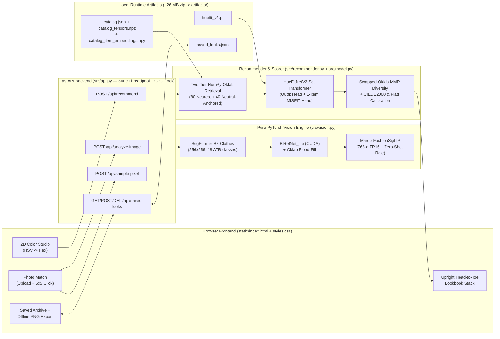
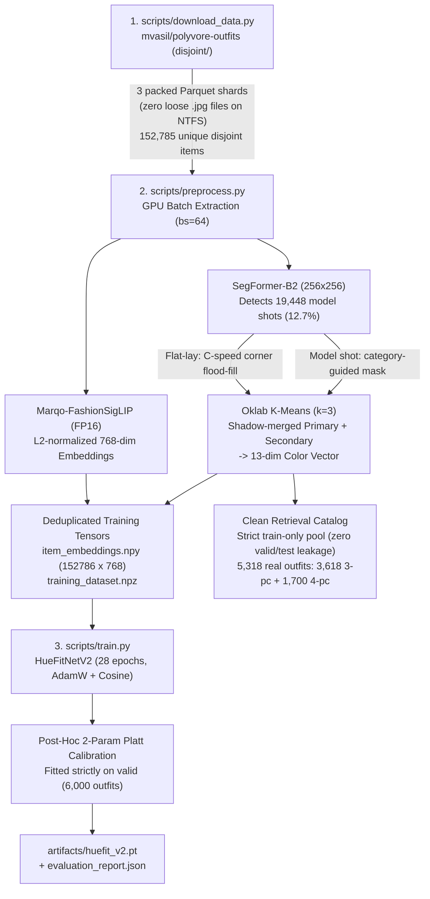
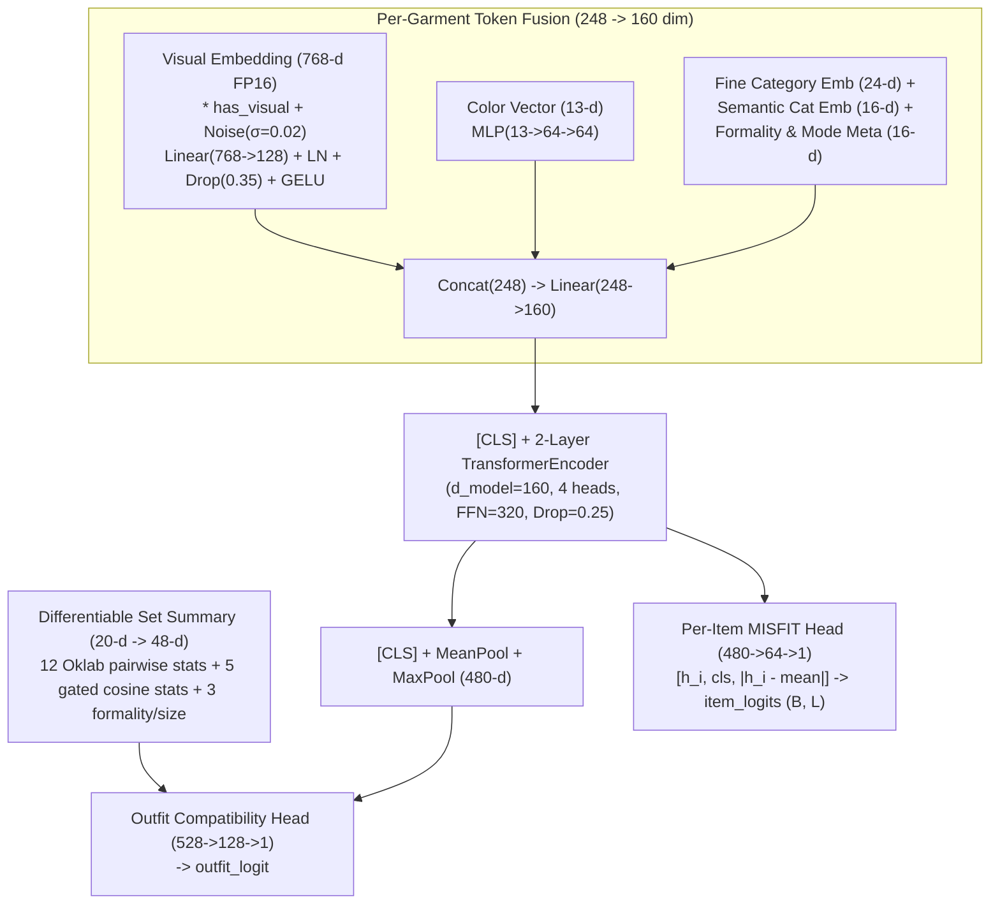

# HueFit — Architecture, Data Pipeline & Contributor Handoff Guide

This document is the complete technical reference for **HueFit**. It explains how the dataset was processed, why every modeling and UI decision was made, the exact tensor/API contracts, non-negotiable engineering invariants, and how to extend or swap the AI architecture without breaking downstream components.

---

## 1. High-Level System Architecture

HueFit runs as a **100% pure-PyTorch**, zero-ONNX, zero-pickle local web application (~1.1 GB VRAM on CUDA, ~35–50 ms live recommendation latency).



---

## 2. Repository Map

```text
HueFit/
├── launch.py                      # Main-thread uvicorn launcher, QuickEdit guard, port check & browser open
├── HueFit.bat                     # Unified self-bootstrapping Windows folder launcher (auto-setup + run)
├── requirements.txt               # Lean runtime dependencies
├── requirements-train.txt         # Optional training, evaluation & plotting dependencies
├── README.md                      # User-facing overview, benchmarks & quickstart
├── ARCHITECTURE.md                # This file — full engineering & handoff blueprint
├── LICENSE                        # MIT License
│
├── src/                           # Runtime Python package (zero dead modules)
│   ├── __init__.py
│   ├── config.py                  # Central paths, HF model IDs, device/AMP helpers, release URL
│   ├── color_math.py              # Vectorized sRGB<->Oklab, chroma-gated hue, CIEDE2000, 54 anchors
│   ├── vision.py                  # SegFormer-B2, BiRefNet_lite, C-speed Oklab flood-fill, 5x5 sampler
│   ├── model.py                   # HueFitNetV2 Variable-Length Set Transformer (661,850 params)
│   ├── recommender.py             # Two-Tier retrieval, Platt scoring, MMR diversity, Outfit Audit
│   └── api.py                     # FastAPI app, NoCacheStaticFiles, zero-shot SigLIP role, SavedLooksStore
│
├── static/                        # 100% offline frontend (zero external CDN requests)
│   ├── index.html                 # Single-page Light/Dark studio + Canvas PNG exporter
│   ├── styles.css                 # Adaptive Light (#F5F3EE) & Dark (#0D0C0B) WCAG-AA stylesheets
│   └── huefit.ico                 # Multi-resolution app icon (browser favicon + optional shortcut)
│
├── docs/figures/                  # High-resolution (300 DPI) architecture & evaluation charts
│   ├── 01_architecture_pipeline.png
│   ├── 02_training_dynamics.png
│   ├── 03_roc_pr_calibration.png
│   ├── 04_model_comparison_fitb.png
│   └── 05_confusion_and_sensitivity.png
│
├── scripts/                       # Verification, release, visual & reproducible training scripts
│   ├── download_data.py           # Downloads Polyvore disjoint splits + packed Parquet image shards
│   ├── preprocess.py              # Streams 152,785 images -> Oklab + SigLIP + clean 5,318-outfit catalog
│   ├── train.py                   # Trains HueFitNetV2, Platt calibration, LightGBM + FITB evaluation
│   ├── generate_visuals.py        # Renders the 5 300-DPI presentation charts into docs/figures/
│   ├── test_api.py                # In-process end-to-end API, recommender & persistence test suite
│   ├── preflight_check.py         # Live TCP launch.py + static asset + syntax pre-push verification
│   ├── package_release.py         # Builds ~26 MB dist/huefit-runtime-artifacts.zip + SHA-256
│   ├── download_artifacts.py      # Downloads & safely extracts release bundle into artifacts/
│   └── create_shortcut.py         # Regenerates static/huefit.ico & optional Windows Desktop shortcut
│
├── artifacts/                     # Runtime binaries (via Release zip) + local saved_looks.json
└── data/polyvore_raw/             # Optional raw Polyvore Parquet shards (gitignored, training only)
```

---

## 3. End-to-End Data & Training Pipeline



### Key Data Hygiene Decisions
1. **Zero NTFS File Explosion:** `mvasil/polyvore-outfits` stores images in packed Parquet shards (`data/disjoint/{train,validation,test}.parquet`). `preprocess.py` streams 256 rows at a time via `pyarrow` in memory without unpacking 150k+ `.jpg` files onto disk, checkpointing every 25,000 items.
2. **Strict Disjoint Train-Only Pools:** Official Polyvore `disjoint/` splits contain small metadata overlap (`train ∩ valid = 3,781`, `train ∩ test = 84`). Both the dynamic negative sampler (`train_pool_by_cat`) and the curated catalog strictly exclude any item in `valid` or `test` (`strict_train_only_ids = 68,127` items).
3. **Zero Synthetic Outerwear:** Outfits without a jacket are stored natively as 3-piece ensembles (`outerwear: null`, `has_outerwear: false`). No synthetic jackets are ever imputed.
4. **Category-Guided Color Extraction:** Roughly 12.7% (`19,448`) of Polyvore photos show human models. SegFormer masks strictly to the item's `semantic_category` class IDs so skin and background denim never contaminate colors. Flat-lays use tight corner-seeded Oklab flood-fill (`tol=0.022` on white backdrops) with connected-component watermark removal, preserving ivory (`#F8F5EE`) and cream (`#F5F5DC`) at $\Delta E_{00} = 0.00$.
5. **Title Normalization:** Strips URL encoding (`%C3%A9` → `é`), NFKC artifacts, mojibake (`??`), prices (`$39.99`), and retailer prefixes (`SheIn(sheinside)`).

---

## 4. Perceptual Color Math & Feature Contracts (`src/color_math.py`)

### 13-Dimensional Garment Color Vector
Every garment is represented by a continuous 13-dim vector (`encode_garment_color`):

| Slice | Dimensions | Definition | Purpose |
| :--- | :---: | :--- | :--- |
| `[0:3]` | 3 | Primary Oklab $(L^*, a^*, b^*)$ | Perceptually uniform lightness & opponent channels |
| `[3:6]` | 3 | Primary $[C^*, g\cos(h), g\sin(h)]$ where $g = \frac{C^*}{C^* + 0.02}$ | **Chroma-gated hue:** neutrals ($C^* \approx 0$) smoothly collapse to $(0, 0)$ with zero $0^\circ / 360^\circ$ discontinuity |
| `[6:9]` | 3 | Secondary Oklab $(L^*, a^*, b^*)$ | Secondary fabric color (identical to primary for solid garments) |
| `[9:12]` | 3 | Secondary $[C^*, g\cos(h), g\sin(h)]$ | Chroma-gated secondary hue |
| `[12]` | 1 | `primary_share` $\in [0.5, 1.0]$ | Coverage weight of primary vs. secondary color |

### Color Naming & Secondary Trim Gating
* **54-Anchor Oklab Dictionary:** Identical 54 fashion color anchors live in both `src/color_math.py` and `static/index.html` (including `Off Black #232428` between `Black` and `Charcoal`).
* **Distinct Trim Gate:** In `src/recommender.py`, a secondary fabric accent chip is surfaced to the user **only** when `CIEDE2000(primary, secondary) >= 12.0` AND `primary_share <= 0.88`.

---

## 5. Neural Architecture: `HueFitNetV2` (`src/model.py`)

`HueFitNetV2` is a **Variable-Length Set Transformer** (`2` to `12` items, **661,850** trainable parameters) trained for both full multimodal photo scoring and pure color-wheel scoring with zero visual leakage.



### Training & Calibration Protocol (`scripts/train.py`)
* **Whole-Outfit Modality Dropout:** 45% all-slots Color-Only (`has_visual=0`), 45% all-slots Multimodal (`has_visual=1`), 10% single-slot partial drop. Zeroing all visual pathways in Color-Only mode is unit-tested to `0.00000000` visual leakage.
* **Dynamic On-the-Fly Negatives:** 50% all-item same-category swaps + 50% 1-item swaps sampled each epoch strictly from `strict_train_only_ids`.
* **Loss & Optimization:** $\mathcal{L} = \text{BCE}(\text{outfit}) + 0.35\,\text{BCE}(\text{item})$, Label Smoothing (`0.03`), AdamW (`lr=1e-3`, `wd=1e-2`), 2-epoch warmup + cosine decay, gradient clip `1.0`, `num_workers=0`.
* **2-Parameter Platt Calibration:** Fitted via L-BFGS strictly on `valid` separately for Multimodal (`a=1.70287, b=-0.43452`) and Color-Only (`a=1.70990, b=0.25297`).

### Verified Benchmarks (Unseen Polyvore Disjoint Test Set)

| Model | Test Outfits | ROC-AUC | PR-AUC | Accuracy | F1 | ECE | FITB Top-1 (`n=15,145`) |
| :--- | :---: | :---: | :---: | :---: | :---: | :---: | :---: |
| **HueFitNetV2 (Multimodal)** | 30,290 | **0.9005** | **0.9020** | **81.57%** | **0.8137** | 0.0462 | **60.79%** *(random 25%)* |
| **HueFitNetV2 (Color-Only)** | 30,290 | **0.8350** | **0.8405** | **73.99%** | **0.7628** | 0.0378 | **50.96%** *(random 25%)* |
| LightGBM Baseline (Multimodal) | 30,290 | 0.8244 | 0.8387 | 74.11% | 0.7447 | 0.0201 | — |
| LightGBM Baseline (Color-Only) | 30,290 | 0.7501 | 0.7693 | 67.56% | 0.6900 | 0.0180 | — |

**Color-Swap Sensitivity Audit (500 real catalog outfits, Color-Only mode):**
Neon Magenta **-25.76 pp** (`87.2%` penalized), Neon Lime **-18.96 pp** (`82.2%` penalized), Safety Orange **-16.95 pp** (`78.0%` penalized).

---

## 6. Inference, Live Vision & Runtime Contracts

### Two-Tier Vectorized Retrieval (`src/recommender.py`)
1. Exact pre-filter (`outerwear_mode` + `style`) with honest fallback notices if `< 16` strict matches exist.
2. Two-Tier NumPy candidate pool: **80** Oklab-nearest + **40** neutral-anchored outfits.
3. Single-batch GPU pass through `HueFitNetV2` + Swapped-Oklab MMR diversity (`±0.095` jitter / `0.26` diversity weight when shuffled).

### Live Photo Pipeline (`src/vision.py` + `src/api.py`)
1. EXIF transpose + RGBA alpha extraction + `1024 px` cap.
2. `SegFormer-B2-Clothes` (`256×256`) detects human outfits (`>=1.2%` body pixels or `>=2` distinct garments).
3. Flat-lays use `BiRefNet_lite` on CUDA (automatically falls back to fast C-speed Oklab flood-fill on CPU-only laptops).
4. Zero-shot `Marqo-FashionSigLIP` text prompts classify `top` vs `outerwear` vs `bottom` vs `footwear`.
5. Multi-piece uploads (`>=2` garments) run an **Outfit Audit** with calibrated per-item fit scores.

### Runtime Artifacts (`dist/huefit-runtime-artifacts.zip` — 26.04 MB)

| File | Shape / Schema | Purpose |
| :--- | :--- | :--- |
| `huefit_v2.pt` | `state_dict`, `config`, Platt `(a, b)` & thresholds | Neural compatibility scorer |
| `catalog.json` | 5,318 outfit dicts (`set_id`, `style`, `has_outerwear`, `colors`, `titles`, ...) | Display metadata |
| `catalog_tensors.npz` | `slot_item_idx`, `slot_oklab`, `slot_color_feats`, `slot_cat_ids`, `slot_sem_cats`, `slot_formality`, `slot_mask`, `style_codes`, `has_outerwear`, `neutral_ratio` | Vectorized retrieval & model tensors |
| `catalog_item_embeddings.npy` | `(16361, 768)` `float16` L2-normalized | Deduplicated catalog FashionSigLIP vectors |
| `item_mappings.json` | Slimmed `sem_cat_to_idx` | Semantic category lookup |
| `evaluation_report.json` | Disjoint AUC, FITB, sensitivity metrics | Health summary |
| `saved_looks.json` *(local only)* | Atomic JSON list (max 50 looks) | Permanent user saved archive |

### FastAPI Endpoints (`src/api.py`)

| Method & Route | Payload / Behavior |
| :--- | :--- |
| `GET /`, `GET /static/*`, `GET /favicon.ico` | Serves UI, `NoCacheStaticFiles`, and icon with `Cache-Control: no-cache` |
| `GET /api/health` | Device, VRAM allocated, catalog count, model readiness & metrics |
| `POST /api/analyze-image` | Multipart image (`<=10 MB`) → segmentation, SigLIP crop vectors, zero-shot roles, optional `outfit_audit` |
| `POST /api/sample-pixel` | `{upload_id, x_pct, y_pct, target_role?}` → 5×5 median patch synced to nearest crop embedding & selected slot |
| `POST /api/recommend` | `{locks, style, outerwear_mode, upload_id?, shuffle_seed, top_k}` → Top-K diverse palettes with gated `secondary_colors` |
| `GET/POST /api/saved-looks`, `DELETE /api/saved-looks/{id}` | Atomic disk CRUD for `artifacts/saved_looks.json` |

---

## 7. Non-Negotiable Engineering Invariants (Do Not Break)

1. **Pure PyTorch Only:** Never add `onnxruntime` or `rembg` (CUDA 12.8 DLL conflicts on Blackwell `sm_120`).
2. **Main-Thread `uvicorn` + Sync Routes + `threading.Lock`:** Keep `uvicorn.run()` on the main thread (`launch.py`), keep GPU routes `def` (threadpool) guarded by `STATE.gpu_lock`, and disable Windows Console QuickEdit so clicking the console never freezes the server.
3. **No `BaseHTTPMiddleware`:** Keep `NoCacheStaticFiles` instead of `@app.middleware("http")` to prevent Starlette stream stalls on aborted browser fetches.
4. **SegFormer Input Cap (`256×256`):** Never revert to `512×512` (spikes past 16 GB VRAM during batch extraction).
5. **AMP Compatibility:** Always use `get_amp_dtype(device)` instead of hardcoding `torch.bfloat16` (Turing/Pascal GPU safety).
6. **Windows Batch Hygiene:** Never place `%~dp0` inside `if (...)` blocks in `.bat` files (folder paths with parentheses break `cmd.exe`).
7. **Whole-Outfit Modality Separation & Achromatic Chrome:** Never mix visual catalog embeddings with manual color locks during scoring, and keep `Light` (`#F5F3EE`) / `Dark` (`#0D0C0B`) chrome free of blue/cyan tint.

---

## 8. Playbook: Swapping or Upgrading the AI Architecture

* **Swap Visual Encoder:** Update `FASHIONSIGLIP_MODEL_ID` + `VISUAL_DIM` in `src/config.py`, update `encode_fashionsiglip_batch()` (`scripts/preprocess.py`) and `encode_crops()` / `_build_role_text_embeddings()` (`src/api.py`), then re-run `preprocess.py` → `train.py` → `package_release.py`.
* **Swap Compatibility Scorer:** Keep the `forward(visual_emb, color_feats, cat_ids, sem_cats, formality, pad_mask, has_visual) -> (outfit_logit, item_logits)` signature and `get_config()` in `src/model.py`, then re-run `scripts/train.py`. Calibration, FITB, recommender, and UI work unchanged.
* **Add Garment Slots:** Extend `ROLES` (`src/config.py`), `CATEGORY_TO_ROLE` (`scripts/preprocess.py`), `ROLE_ZERO_SHOT_PROMPTS` (`src/api.py`), and add the corresponding slab in `static/index.html`.
* **Swap Dataset:** Emit the same `catalog.json`, `catalog_tensors.npz`, and `catalog_item_embeddings.npy` schemas — zero backend or frontend changes needed.