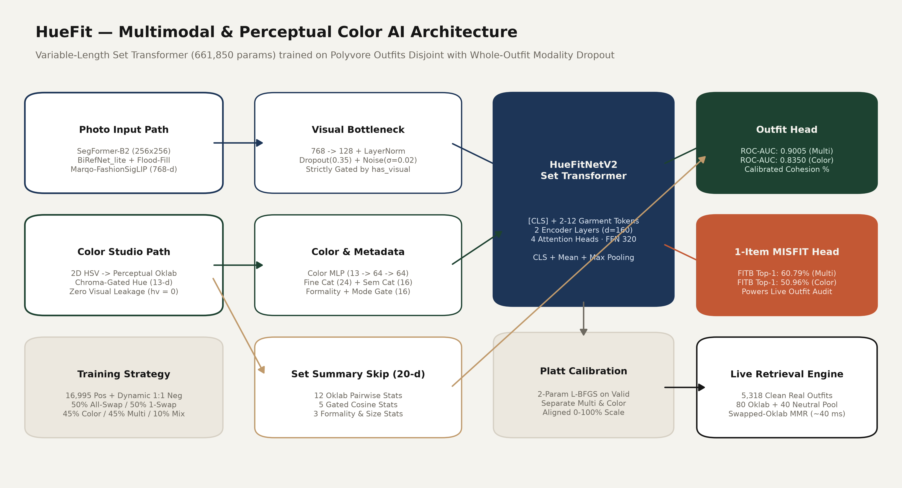
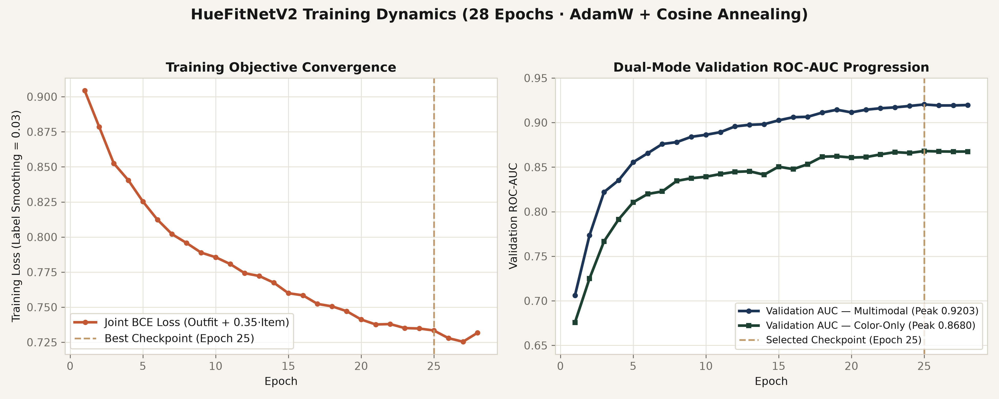
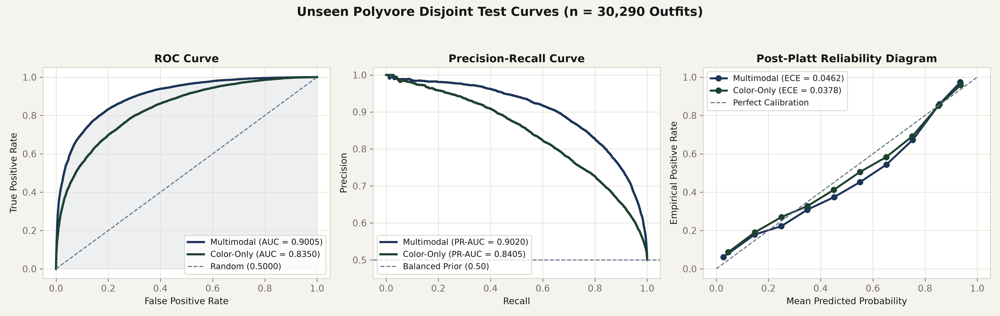
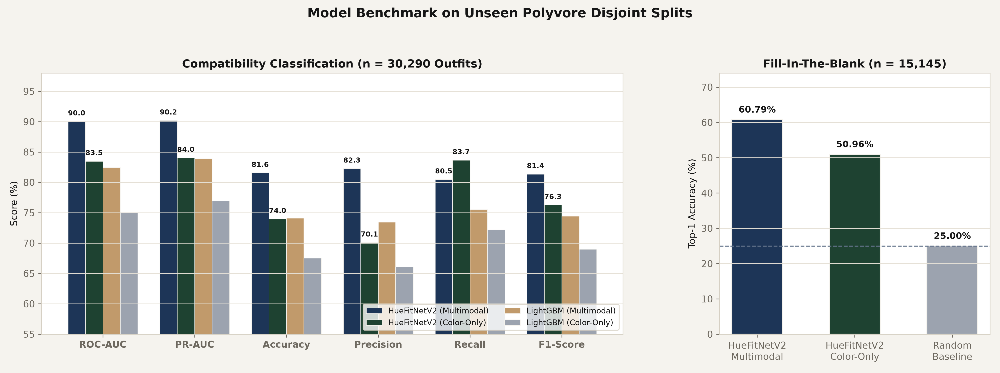
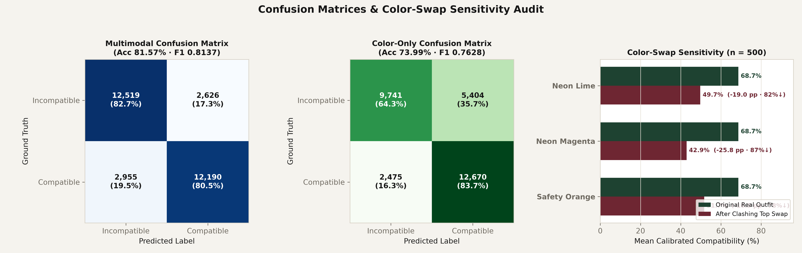

# HueFit — Outfit Color Recommender

A local, offline-ready **outfit color and multimodal style recommender** powered by a Variable-Length Set Transformer, perceptual **Oklab / CIEDE2000** color modeling, **SegFormer-B2-Clothes**, **BiRefNet**, and **Marqo-FashionSigLIP**.

> **For Developers & Contributors:** See [**ARCHITECTURE.md**](ARCHITECTURE.md) for the complete technical blueprint, data pipeline, tensor/API contracts, and model-swap guide.

## Highlights

- **Upright Head-to-Toe Lookbook:** Visualizes outfits vertically (Top + optional Outerwear → Trousers → Footwear) across **5,318** real Polyvore ensembles (native 3-piece and 4-piece outfits, zero synthetic outerwear).
- **Dual-Mode Input:** Pick shades from a 2D Color Studio or upload flat-lay / full-body outfit photos for automatic garment parsing, 5×5 denoised click sampling, zero-shot role detection, and a multi-piece **Outfit Audit**.
- **Iterative Multi-Slot Pinning:** Pin 1 to 3 garments simultaneously (`Top`, `Outer`, `Bottom`, `Shoes`), filter by occasion (`All` / `Casual` / `Formal`) and jacket layer (`Any` / `Jacket` / `Clean`), and shuffle diverse MMR-ranked looks.
- **Persistent Archive & Lookcard Export:** Save favorite looks permanently to disk (`artifacts/saved_looks.json`) and export Light/Dark PNG lookcards offline.
- **Adaptive Light & Dark Themes:** Warm linen Light mode and warm obsidian Dark mode with zero external CDN dependencies.

## How It Works



---

## Getting Started

### Requirements
- **Python 3.12** *(3.10–3.12 supported)* — download from [python.org](https://www.python.org/downloads/) and **check "Add Python to PATH"** during installation.
- **Hardware:** Works on any **NVIDIA GPU** (auto-accelerated via CUDA, ~1.1 GB VRAM, ~40 ms per recommendation) **or CPU-only laptops** (no GPU required).
- **Disk Space:** ~3–6 GB total once local dependencies and vision weights finish downloading. No Hugging Face account or API key is required.

### Option 1: Windows (Recommended — 1-Click, No Terminal Needed)

1. Click the green **Code** button above → **Download ZIP** and extract the folder anywhere on your PC *(or run `git clone https://github.com/AstaPasta0/HueFit.git`)*.
2. Open the folder and double-click **`HueFit.bat`**.
3. **First launch only (~3–5 min):** `HueFit.bat` handles everything automatically inside the folder — it creates a local virtual environment (`venv/`), detects NVIDIA CUDA vs. CPU, installs dependencies, downloads the prebuilt model bundle (~26 MB), caches the public vision weights (~1.1 GB), and opens HueFit in your default browser.
4. **Every launch after (~5–10 sec):** Just double-click **`HueFit.bat`** again.

> **Tip:** Keep the black HueFit console window open (you can minimize it) while using the site. Close that window whenever you want to stop HueFit.
>
> **Optional Desktop Shortcut:** If you prefer a Desktop icon, run `venv\Scripts\python.exe scripts\create_shortcut.py` once after setup.

### Option 2: macOS / Linux

```bash
git clone [https://github.com/AstaPasta0/HueFit.git](https://github.com/AstaPasta0/HueFit.git)
cd HueFit

python3 -m venv venv
source venv/bin/activate

pip install --upgrade pip
pip install -r requirements.txt
python scripts/download_artifacts.py
python launch.py
```

### Quick Troubleshooting
- **`python` is not recognized on Windows:** Re-run the Python 3.12 installer and make sure **"Add python.exe to PATH"** is checked.
- **Manual artifact download (if offline or behind a proxy):** Grab `huefit-runtime-artifacts.zip` from the **Releases** tab on the right, extract all 6 files directly into the `artifacts/` folder, and run `HueFit.bat` again.
- **Verify your installation anytime:** Run `venv\Scripts\python.exe scripts\preflight_check.py`.

---

## Keyboard Shortcuts

| Key | Action |
| :--- | :--- |
| `Space` | Shuffle fresh diverse looks |
| `←` / `→` | Browse the 8 curated looks |
| `1` – `4` | Select Top / Outer / Bottom / Shoes |
| `D` | Toggle Light / Dark theme |

## Benchmarks & Evaluation (Unseen Polyvore Disjoint Test Set)

Evaluated strictly on the official item-disjoint split (`30,290` compatibility outfits and `15,145` Fill-In-The-Blank questions):

| Model | Disjoint ROC-AUC | PR-AUC | Accuracy | Precision | Recall | F1 | FITB Top-1 (Random 25%) |
| :--- | :---: | :---: | :---: | :---: | :---: | :---: | :---: |
| **HueFitNetV2 (Multimodal)** | **0.9005** | **0.9020** | **81.57%** | **0.8228** | **0.8049** | **0.8137** | **60.79%** |
| **HueFitNetV2 (Color-Only)** | **0.8350** | **0.8405** | **73.99%** | **0.7010** | **0.8366** | **0.7628** | **50.96%** |
| LightGBM Baseline (Multimodal) | 0.8244 | 0.8387 | 74.11% | 0.7345 | 0.7552 | 0.7447 | — |
| LightGBM Baseline (Color-Only) | 0.7501 | 0.7693 | 67.56% | 0.6607 | 0.7220 | 0.6900 | — |






## Optional: Retrain & Regenerate Visuals From Scratch

Requires accepting gated access to `mvasil/polyvore-outfits` on Hugging Face and logging in with `hf auth login`:

```bash
pip install -r requirements-train.txt
python scripts/download_data.py
python scripts/preprocess.py
python scripts/train.py
python scripts/generate_visuals.py
python scripts/package_release.py
```

## License

MIT — see [LICENSE](LICENSE).